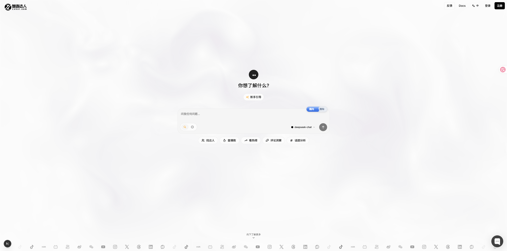

# ZXKOL — Global Social, Creator & E-Commerce Data for AI Agents 🌐

<p align="center"><b>English</b> · <a href="README.zh-CN.md">简体中文</a></p>

> Query creator commercial quotes, viral posts, live trending charts, video transcripts, e-commerce listings, and ad libraries across **34 platforms & 286+ standardized endpoints** — straight from Claude Code, Codex, Cursor, OpenClaw, or any MCP 2.0 client.

<p align="center">
  <a href="https://github.com/kvalen-code/zxkol-skill/stargazers"></a>
  <a href="LICENSE"></a>
  
  
  
</p>

<p align="center">
  <a href="https://zxkol.com"></a>
</p>

**ZXKOL** turns *"screen 100k–500k beauty KOLs on Douyin Xingtu & Xiaohongshu Pugongying and compare today's cross-platform trending topics"* into structured tool calls — zero scrapers, zero cookie maintenance, automatic multi-line failover.

```text
You:    Compare live hotlists on Douyin, Xiaohongshu & TikTok, and find mid-tier beauty creators.
Agent:  → batch_call([douyin.hot.search, xiaohongshu.hot.list, tiktok.trends.hashtags])
        → creator_search(keyword="美妆", followerRange="10-50")
        ✓ Parallel response in 1 round-trip with transparent billing receipt.
```

---

## ✨ What's New in v2.1

- **34 Platforms & 286+ Standardized Endpoints** — Douyin (Xingtu & Index), Xiaohongshu (Pugongying), WeChat (Channels / MP / Search), Bilibili, Kuaishou, Weibo, Zhihu, Taobao/Tmall, Alibaba 1688, Xianyu, TikTok (Shop & Creative Center), YouTube, Instagram, X (Twitter), Reddit, Threads, LinkedIn, Bluesky, Telegram, Meta Ad Library, Google Ads Transparency, Amazon, AliExpress, App Store & more.
- **MCP 2.0 Progressive Disclosure + `batch_call`** — `find` & `describe` work **even without an API key**; `batch_call` executes up to 5 endpoints concurrently in one RTT; `read_more` slices >20KB responses cleanly without blowing up context windows.
- **Built-in MCP Resources & Prompts** — Read `zxkol://catalog/platforms` and `zxkol://billing/rules`, or invoke `/kol-screening`, `/viral-teardown`, and `/cross-platform-trends`.
- **Transparent Dual-Track Billing** — Universal Standard Call Pool (1x regular / 5x commercial pro) + CNY Wallet seamless fallback. Discovery tools & failed upstream calls are **100% free**.

---

## 🛠 Tool Architecture

### 1. MCP 2.0 Core Primitives (Covers all 34 platforms & 286+ endpoints)

| Tool | Billing | Description |
| :--- | :--- | :--- |
| `find` | **Free (Keyless OK)** | Natural-language search across 286+ endpoints (`query`, `platform`, `limit`). |
| `describe` | **Free (Keyless OK)** | Inspect parameter schema, return entity model, and real-time call/CNY cost for an `endpoint_id`. |
| `call` | Per endpoint | Invoke any `endpoint_id` (`view="compact"` recommended). Includes a first-line `[Receipt]` and auto-chunks payloads >20KB. |
| `batch_call` | Per succeeded item | Execute **1–5 endpoint calls in parallel** in a single round-trip. |
| `read_more` | **Free** | Read the next 20KB slice of a cached response via `cache_id` + `offset`. |
| `account` | **Free** | Check remaining standard calls, equivalent pro calls, CNY wallet balance & VIP discount. |

### 2. High-Level Multi-Platform Aggregators

| Tool | What it does |
| :--- | :--- |
| `creator_search` | Search Douyin Xingtu official commercial creators (followers, quote tiers, e-commerce level) |
| `douyin_star` | Deep Douyin Xingtu KOL dossier (`profile`, `audience`, `price`, `data_overview`, `similar`) |
| `douyin_index` | Douyin Index (`keyword_hot_trend`, `hot_words`, `brand_radar`, `similar_creators`) |
| `content_search` | Multi-platform viral video & post search with unified schema |
| `hot_list` | Real-time trending charts across 13+ major platforms |
| `content_detail` | Single post stats, author info, and media links |
| `comment_insight` | AI comment sentiment, user pain points, buying triggers & content hooks |
| `hashtag_search` / `hashtag_posts` | Topic & challenge discovery plus top-performing posts |

---

## 🚀 Quick Start (2 Minutes)

### 1. Get an API Key
1. Sign up at **[zxkol.com](https://zxkol.com)** (free welcome calls included).
2. Go to **[Console → API Keys](https://zxkol.com/dashboard/api-keys)** and create a `zxk_live_...` key.

### 2. Install Skill + MCP Server

**One-line Skill pull (Claude Code / Codex / OpenClaw):**
```bash
mkdir -p ~/.claude/skills/zxkol
curl -fsSL https://zxkol.com/skill.md -o ~/.claude/skills/zxkol/SKILL.md
```

**Configure MCP (`~/.claude/mcp.json`, `.mcp.json`, or `~/.cursor/mcp.json`):**
```json
{
  "mcpServers": {
    "zxkol": {
      "type": "http",
      "url": "https://zxkol.com/api/mcp",
      "headers": {
        "Authorization": "Bearer zxk_live_YOUR_KEY"
      }
    }
  }
}
```

---

## 📚 Official Links

- 🌐 **Website & AI Workspace** — [https://zxkol.com](https://zxkol.com)
- 📄 **Live Skill Feed** — [https://zxkol.com/skill.md](https://zxkol.com/skill.md)
- 📖 **34-Platform API Reference** — [https://zxkol.com/docs/api](https://zxkol.com/docs/api)
- 🔌 **MCP Setup Guide** — [https://zxkol.com/docs/mcp](https://zxkol.com/docs/mcp)
- 💳 **Transparent Pricing** — [https://zxkol.com/pricing](https://zxkol.com/pricing) ([`/prices.json`](https://zxkol.com/prices.json))
- 🤖 **LLM Index** — [`/llms.txt`](https://zxkol.com/llms.txt) · [`/llms-full.txt`](https://zxkol.com/llms-full.txt)

---

## License

[MIT](LICENSE) — applies to the config, docs, and skill manifest in this repo. Hosted API & MCP data services are subject to [zxkol.com/terms](https://zxkol.com/terms).
